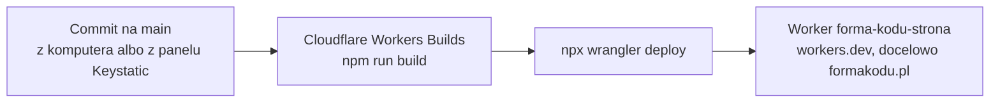

# Architektura

## Składniki

| Warstwa | Technologia | Gdzie w kodzie |
|--|--|--|
| Strony | Astro 7, generowane z góry do HTML (prerender) | `src/pages/*.astro`, komponenty `src/components/<strona>/S<n>*.astro` |
| Treść | pliki JSON i Markdown w repozytorium, kolekcje Astro | `src/content/`, schemat `src/content.config.ts` |
| Panel treści | Keystatic 0.6 pod `/keystatic`; zapis = commit w GitHubie | `keystatic.config.ts`, `src/keystatic/` |
| Zachowania | jeden skrypt bez bibliotek (menu, formularze, zakładki, swipe) | `src/scripts/strona.ts` |
| Ruch | jeden moduł według tabeli Figma 06 Motion `390:2` | `src/scripts/ruch.ts`, `src/styles/animacje.css` |
| Formularze | funkcje serwera w tym samym Workerze | `src/pages/api/*.ts`, `src/lib/formularz.ts` |
| Wysyłka e-mail | Brevo (Francja), jedyny plik rozmawiający z dostawcą | `src/lib/wysylka.ts` |
| Hosting | Cloudflare Workers + statyczne pliki (assets) | `wrangler.jsonc`, `public/_headers` |
| SEO/GEO | JSON-LD, `llms.txt`, wersje `.md` stron, sitemap | `src/lib/schema.ts`, `scripts/generuj-markdown.mjs`, `public/` |

## Jak strona trafia do internetu

Gałęzie robocze (`claude/...`) nie wdrażają się same; wdrożenie następuje po scaleniu do `main`.

## Dane firmy: jedno źródło

`src/content/ustawienia/firma.json` zasila stopkę, politykę, klauzule, JSON-LD i `llms.txt` (zasada 11). Puste pole (np. NIP, rok założenia) = element niewidoczny na stronie i w JSON-LD.

## Kontrole

- `npm run verify`: budowanie + treść + SEO + budżet JS + raport zaślepek (wersja testowa).
- `npm run release`: to samo, ale zaślepki `[…]` przerywają budowanie (wersja do publikacji).
- `npm run ustaw-date -- RRRR-MM-DD`: data pierwszej publikacji w polach aktualizacji.
- `npm run przeglad`: treści starsze niż 90 dni (przegląd kwartalny).
